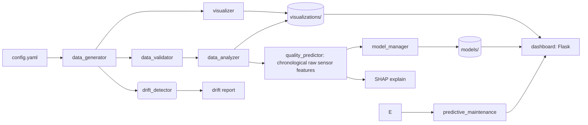
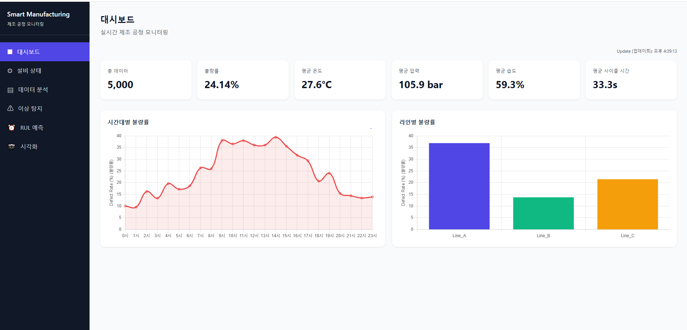
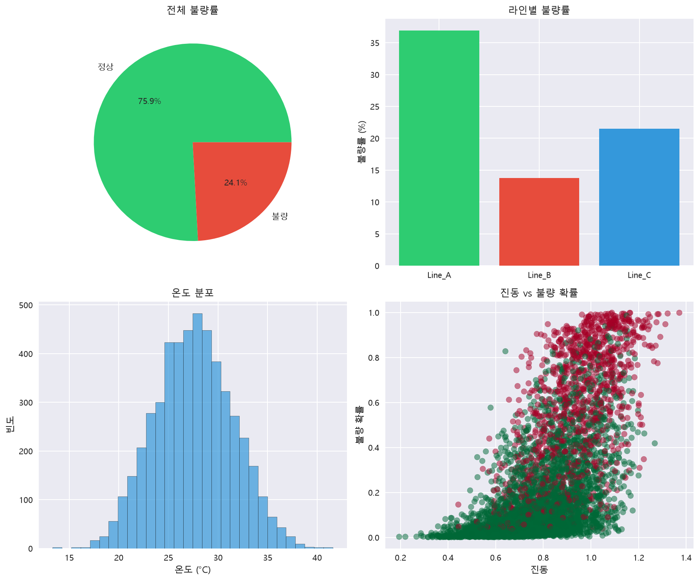

# Smart Manufacturing ML Portfolio


## 20초 요약

> **문제** — 합성 제조 센서 데이터에서 불량 조기 탐지와 공정 이상 모니터링을 재현했습니다.
>
> **구현** — 타임스탬프가 있는 원본 데이터는 시간 순서로 분할해 미래 정보 누수를 막고, RandomForest·Isolation Forest, SHAP, KS/PSI 드리프트 감지와 Flask 대시보드를 Docker 파이프라인으로 구성했습니다. SQLite에는 합성 데이터 실행 이력, 센서 관측, held-out test 예측, 모델 artifact checksum·test 지표, 드리프트 결과를 저장합니다.
>
> **결과** — 최신 수치는 실행 시 SQLite의 `model_metrics`에서 자동 생성되는 [최신 모델 성능 증빙](docs/latest_model_metrics.md)을 확인합니다. 합성 데이터 기반 결과이므로 실제 생산 라인 성능을 주장하지 않습니다.
>
> **실행** — [Docker·로컬 실행 방법](#quick-start)으로 전체 파이프라인과 대시보드를 재현할 수 있습니다.

> **면접용 최신 증빙** — [PORTFOLIO_EVIDENCE.md](PORTFOLIO_EVIDENCE.md)에 최신 테스트·Docker·SQLite 검증 결과를 한 페이지로 정리했습니다.

> 제조 공정 데이터 분석 및 예측 AI 포트폴리오

---

## Quick Start

### Docker (권장)

```bash
docker compose up --build
```

`app` 서비스가 전체 파이프라인을 실행한 후 종료됩니다. `dashboard` 서비스는 `http://localhost:5000`에서 계속 동작합니다 (로컬 실행 시 `config.yaml`의 `dashboard.port` 기본값 5001).

### 로컬 실행

```bash
python -m venv venv
venv\Scripts\activate          # Windows
# source venv/bin/activate     # macOS/Linux
pip install -r requirements-tested.txt
python main.py                 # 전체 파이프라인 실행
python dashboard/app.py        # 대시보드 (http://localhost:PORT, 기본 5001)
pytest -v                      # 테스트 (86개)
```

---

## 아키텍처



## 프로젝트 개요

이 프로젝트는 제조 공정 데이터를 분석하고 불량을 예측하는 AI 시스템입니다.

### 핵심 기능

| 기능 | 설명 | 기술 |
|------|------|------|
| **품질 예측** | 센서 데이터 기반 제품 불량 예측 | RandomForest (class_weight balanced, threshold tuning) |
| **이상 탐지** | 비정상 공정 패턴 자동 탐지 | Isolation Forest |
| **설비 모니터링** | 설비 건강 점수 및 RUL 예측 | 임계값 + 신뢰도 모델 |
| **설정 중심 아키텍처** | `config/config.yaml` 기반 설정 관리 | PyYAML, deep-merge |
| **SHAP 해석** | 개별 예측에 대한 특성 기여도 분석 | TreeExplainer, KernelExplainer |
| **데이터 드리프트 감지** | 실시간 분포 변화 모니터링 | KS test + PSI |
| **SQL 이력 관리** | 실행·센서·모델·드리프트 결과의 조회 가능한 이력 | SQLite, parameterized SQL, FK |
| **실시간 대시보드** | 인터랙티브 모니터링 UI | Flask, Chart.js |

### 기술 스택

- **Language**: Python 3.12
- **ML**: Scikit-learn (RandomForest, GradientBoosting, VotingClassifier)
- **Data**: Pandas, NumPy, SciPy
- **Interpretability**: SHAP
- **Visualization**: Matplotlib, Seaborn, Chart.js
- **Web**: Flask, Bootstrap
- **Infrastructure**: Docker, docker-compose, GitHub Actions
- **Testing**: pytest (78 tests)

---

## 실행 내용

`python main.py` 실행 시 다음 단계가 순차적으로 진행됩니다:

1. 설정 로드 (`config/config.yaml`)
2. 제조 공정 데이터 생성
3. 데이터 검증 (스키마, 결측치, 범위)
4. 데이터 분석 (불량률, 통계)
5. 원본 센서 5개 특성으로 시간 순서 학습/검증/테스트 분할
6. 품질 예측 모델 학습 + **SHAP 설명 출력**
7. 예측 정비 분석 (RUL)
8. **데이터 드리프트 감지** (KS + PSI)
9. 시각화 생성 (4종 PNG)

---

## 프로젝트 구조

```
manufacturing-simulation-portfolio/
├── README.md
├── requirements.txt                 # 유지보수용 최소 버전 명세
├── requirements-tested.txt          # 검증된 정확한 런타임 버전
├── PORTFOLIO_EVIDENCE.md            # 면접용 최신 실행 증빙
├── main.py                          # 전체 파이프라인
├── Dockerfile                       # 컨테이너 이미지
├── docker-compose.yml               # app + dashboard 서비스
├── .dockerignore
├── .github/workflows/ci.yml         # GitHub Actions CI
│
├── config/
│   ├── config.yaml                  # 런타임 설정
│   └── equipment.json               # 설비 정보
│
├── src/
│   ├── config.py                    # 설정 관리 (deep-merge)
│   ├── logging_config.py            # 구조화된 로깅 설정
│   ├── data_generator.py            # 물리적 기반 데이터 생성
│   ├── data_validator.py            # 데이터 검증
│   ├── data_pipeline.py             # 전처리 + 특성 엔지니어링
│   ├── data_analyzer.py             # 데이터 분석
│   ├── quality_predictor.py         # 품질 예측 + SHAP
│   ├── anomaly_detector.py          # 이상 탐지
│   ├── model_manager.py             # 모델 저장/로드/버전 관리
│   ├── hyperparameter_tuner.py      # 하이퍼파라미터 튜닝
│   ├── predictive_maintenance.py    # 예측 정비 (RUL)
│   ├── drift_detector.py            # 데이터 드리프트 감지
│   └── visualizer.py                # 시각화
│
├── dashboard/                       # Flask 대시보드
│   ├── app.py
│   ├── templates/index.html
│   └── static/{css/style.css, js/dashboard.js}
│
├── tests/                           # 86개 테스트
│   ├── test_config.py
│   ├── test_data.py
│   ├── test_model.py
│   ├── test_drift.py
│   ├── test_logging.py
│   ├── test_visualizer.py
│   ├── test_dashboard.py
│   └── test_extended.py
│
├── data/                            # 생성 데이터 (auto)
├── models/                          # 학습 모델 (auto)
│   ├── quality_predictor_latest.joblib
│   └── quality_predictor_latest_meta.json
└── visualizations/                  # 시각화 PNG (auto)
    ├── defect_analysis.png
    ├── time_series.png
    ├── correlation_matrix.png
    └── dashboard_summary.png
```

---

## 데이터 시뮬레이션

### 공정별 차별화

| 라인 | 목적 | 온도 범위 | 압력 범위 | 진동 범위 |
|------|------|-----------|-----------|-----------|
| Line_A | 전자부품 | 22~38°C | 95~115 bar | 0.3~0.9 |
| Line_B | 기계부품 | 18~32°C | 100~125 bar | 0.2~0.7 |
| Line_C | 소비재 | 20~35°C | 90~110 bar | 0.4~0.8 |

### 불량 원인 시뮬레이션

불량 확률은 온도·진동·압력·습도의 복합 위험도를 시그모이드 함수로 매핑합니다.

- **온도**: 30°C 기준으로 높을수록 위험도 증가
- **진동**: 0.5 기준으로 높을수록 위험도 증가
- **압력**: 90~110 bar 범위를 벗어날수록 위험도 증가
- **습도**: 60% 기준으로 높을수록 위험도 증가
- **상호작용**: 고온 상태에서 진동 위험도가 추가로 증폭

---

## 모델 성능 지표

`python main.py`는 모델 등록 후 SQLite의 최신 `model_metrics`를 다시 읽어 [최신 모델 성능 증빙](docs/latest_model_metrics.md)을 갱신합니다. 대시보드 상단의 F1·PR-AUC도 같은 최신 **test split** 값을 API로 읽으므로, 정적 문구가 아닙니다.

> **참고**: AUC-PR이 AUC-ROC보다 낮은 것은 불균형 데이터에서 일반적인 현상입니다.
> 불량 클래스가 약 5~10%인 상황에서 불량을 정확히 찾아내는 것이 핵심 과제입니다.

---

## 시각화 샘플

`python main.py` 실행 후 `visualizations/` 폴더에 생성되는 이미지 (`docs/screenshots/`에도 복사됨):

| 파일 | 설명 |
|------|------|
| `defect_analysis.png` | 불량률 파이차트, 라인별 불량률, 온도 분포, 진동 vs 불량 확률 산점도 |
| `time_series.png` | 시간대별 불량률 추이, 일별 평균 온도 변화 |
| `correlation_matrix.png` | 변수 간 상관관계 히트맵 |
| `dashboard_summary.png` | 핵심 제조 지표 요약 |


*대시보드 메인 화면*


*불량 분석 시각화 예시*

---

## API 문서

| 엔드포인트 | 설명 |
|------------|------|
| `GET /api/v1/summary` | 요약 통계 |
| `GET /api/v1/equipment` | 설비 상태 |
| `GET /api/v1/rul` | 잔여 수명 예측 |
| `GET /api/v1/lines` | 라인별 불량률 |
| `GET /api/v1/trends` | 시간대별 추이 |
| `GET /api/v1/correlation` | 상관관계 매트릭스 |
| `GET /api/v1/anomalies` | 이상 탐지 결과 |
| `GET /api/v1/visualizations` | 시각화 파일 목록 |
| `GET /api/v1/history/quality?from=&to=&line=` | 저장된 실행의 일자·라인별 실제 불량률 SQL 집계 |
| `GET /api/v1/history/models?limit=10` | 모델 버전·artifact checksum 이력 |
| `GET /api/v1/history/models/latest/metrics` | 최신 모델의 test 지표와 threshold |
| `GET /api/v1/history/predictions?from=&to=&line=` | held-out test 예측의 일자·라인별 예측 불량 건수 |
| `GET /api/v1/history/drift/latest` | 마지막으로 저장된 드리프트 실행 결과 |
| `GET /visualizations/<filename>` | 시각화 PNG 이미지 제공 |

상세 문서: [docs/api.md](docs/api.md)

## SQL·모델 이력

`python main.py`는 `data/manufacturing_history.db`에 하나의 실행 이력을 만들고, 합성 센서 관측값·모델 artifact SHA-256·**test** 지표·드리프트 결과를 연결해 저장합니다. 또한 시간순 held-out **test** 관측값마다 불량 확률, 이진 판정, 당시 threshold를 모델 버전과 함께 저장합니다. 따라서 대시보드의 **SQL 이력** 메뉴에서 근거 있는 기간별 예측 불량 건수를 조회할 수 있습니다.

이 저장소는 로컬 재현과 SQL 집계 시연을 위한 SQLite 구현입니다. PostgreSQL 운영 환경, 실제 생산 라인, 실시간 스트리밍 시스템을 구현하거나 검증한 것은 아닙니다.

---

## 주요 설계 의사결정

### 왜 RandomForest를 기본으로 선택했는가?
- 과적합 방지에 강함, 특성 중요도 제공, 비선형 관계 포착 가능

### 클래스 불균형은 어떻게 처리하는가?
- `class_weight='balanced'`로 소수 클래스에 가중치 부여
- 검증 세트에서 F1-score를 최대화하는 확률 임계값 자동 선정 (`_tune_threshold`)
- 타임스탬프가 있는 원본 학습 데이터는 과거 70% / 검증 15% / 미래 테스트 15%의 시간 순서 분할 (타임스탬프가 없는 입력만 계층 무작위 분할로 후퇴)
- 평가 지표로 accuracy 대신 precision, recall, F1, AUC-ROC, AUC-PR 사용

### 왜 탐색용 전처리 결과를 학습 입력으로 쓰지 않는가?

- `DataPipeline`은 특징 생성·스케일링을 살펴보기 위한 독립 유틸리티이며 무작위 분할을 사용한다.
- 실제 `main.py` 학습은 timestamp를 유지한 원본 센서 5개 특성을 `QualityPredictor`에 전달하고, 과거 70% / 검증 15% / 미래 test 15%의 시간순 분할을 적용한다.
- 따라서 탐색용 변환 결과를 평가 입력으로 혼합해 시간 누수나 서로 다른 평가 기준이 생기는 것을 막는다.

### 왜 KS test + PSI 이중 검증인가?
- **KS test**: 분포의 위치·형태 차이 감지에 민감
- **PSI**: 업계 표준 지표로 소규모 이동에도 반응
- PSI 구간은 기준 기간에서만 적합해, 실시간 배치가 기준선을 바꾸지 않도록 함
- 상호 보완적 관계로 위양성률 낮춤

---

## 산출물 관리

`.gitignore`는 대용량/임시 파일만 제외합니다. 다음 대표 산출물은 `python main.py` 실행 후 Git에 포함할 수 있습니다.

- `data/manufacturing_data.csv`
- `models/quality_predictor_latest.joblib`
- `models/quality_predictor_latest_meta.json`
- `visualizations/*.png`

> 모델을 재학습하면 위 파일 내용이 변경되므로, 커밋 전에 `python main.py`를 다시 실행하여 최신 산출물로 갱신하세요.

## 재현성·실행 경계

`requirements-tested.txt`는 2026-11-16에 테스트와 Docker 검증에 사용한 정확한 런타임 직접 의존성 버전입니다. 포트폴리오 재현은 이 파일을 사용하고, 의존성 갱신 작업은 범위 제약이 있는 `requirements.txt`에서 시작합니다. 검증 근거는 [PORTFOLIO_EVIDENCE.md](PORTFOLIO_EVIDENCE.md)에 통합합니다.

대시보드는 Flask 개발 서버로 제공하는 **로컬·합성 데이터 데모**입니다. 운영 배포를 주장하지 않으므로 Gunicorn, 인증, 운영 DB를 이번 범위에 추가하지 않습니다.

---

## 라이선스

MIT License
