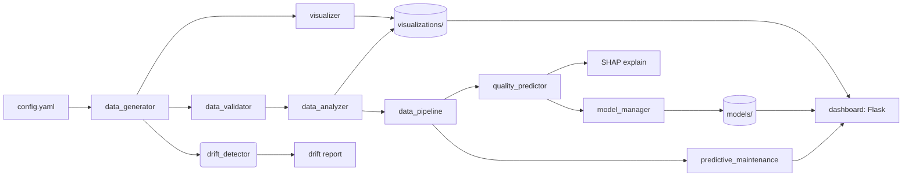
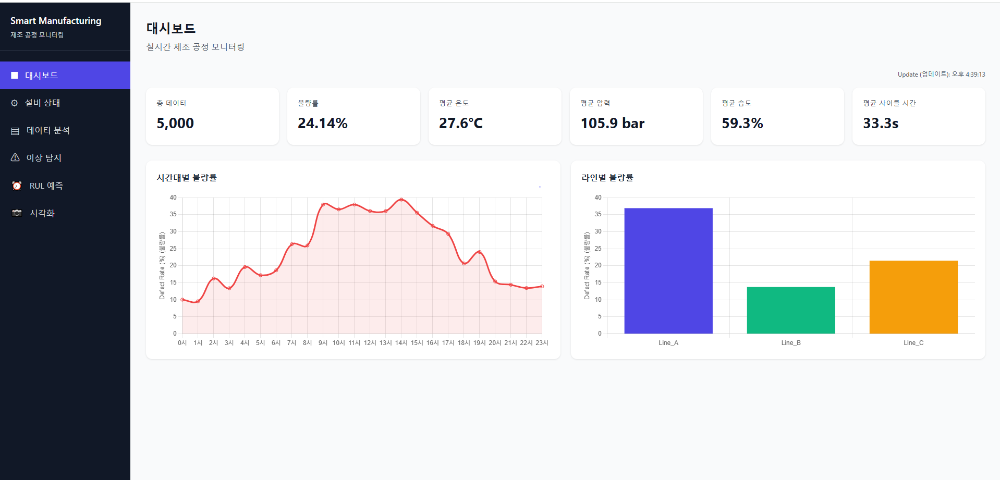
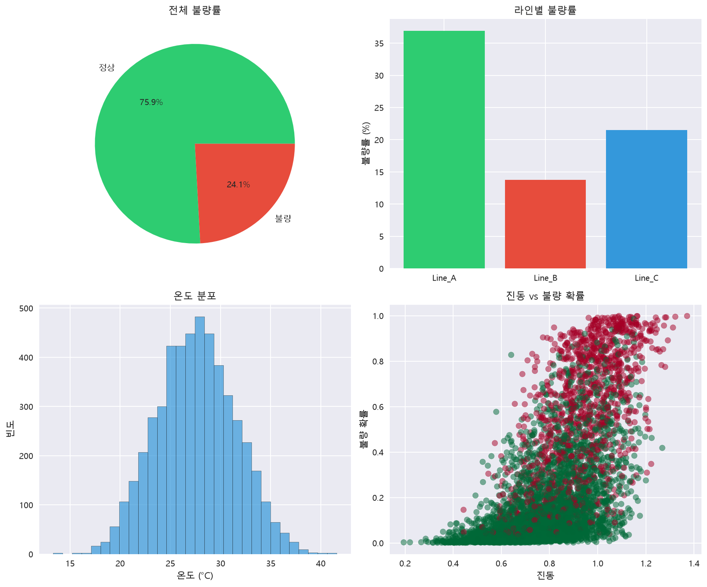

# Smart Manufacturing Simulation Portfolio

[](https://github.com/junwoo1206112/manufacturing-ml-portfolio/actions/workflows/ci.yml)


> 제조 공정 데이터 분석 및 예측 AI 시스템 — 소르테크 지원용 포트폴리오

---

## Quick Start

### Docker (권장)

```bash
docker compose up
```

`app` 서비스가 전체 파이프라인을 실행한 후 종료됩니다. `dashboard` 서비스는 `http://localhost:5000`에서 계속 동작합니다 (로컬 실행 시 `config.yaml`의 `dashboard.port` 기본값 5001).

### 로컬 실행

```bash
python -m venv venv
venv\Scripts\activate          # Windows
# source venv/bin/activate     # macOS/Linux
pip install -r requirements.txt
python main.py                 # 전체 파이프라인 실행
python dashboard/app.py        # 대시보드 (http://localhost:PORT, 기본 5001)
pytest -v                      # 테스트 (78개)
```

---

## 아키텍처



## 프로젝트 개요

이 프로젝트는 제조 공정 데이터를 분석하고 불량을 예측하는 AI 시스템입니다.

### 핵심 기능

| 기능 | 설명 | 기술 |
|------|------|------|
| **품질 예측** | 센서 데이터 기반 제품 불량 예측 | RandomForest (class_weight balanced, threshold tuning) |
| **이상 탐지** | 비정상 공정 패턴 자동 탐지 | Isolation Forest |
| **설비 모니터링** | 설비 건강 점수 및 RUL 예측 | 임계값 + 신뢰도 모델 |
| **설정 중심 아키텍처** | `config/config.yaml` 기반 설정 관리 | PyYAML, deep-merge |
| **SHAP 해석** | 개별 예측에 대한 특성 기여도 분석 | TreeExplainer, KernelExplainer |
| **데이터 드리프트 감지** | 실시간 분포 변화 모니터링 | KS test + PSI |
| **실시간 대시보드** | 인터랙티브 모니터링 UI | Flask, Chart.js |

### 기술 스택

- **Language**: Python 3.12
- **ML**: Scikit-learn (RandomForest, GradientBoosting, VotingClassifier)
- **Data**: Pandas, NumPy, SciPy
- **Interpretability**: SHAP
- **Visualization**: Matplotlib, Seaborn, Chart.js
- **Web**: Flask, Bootstrap
- **Infrastructure**: Docker, docker-compose, GitHub Actions
- **Testing**: pytest (78 tests)

---

## 실행 내용

`python main.py` 실행 시 다음 단계가 순차적으로 진행됩니다:

1. 설정 로드 (`config/config.yaml`)
2. 제조 공정 데이터 생성
3. 데이터 검증 (스키마, 결측치, 범위)
4. 데이터 분석 (불량률, 통계)
5. 특성 엔지니어링 및 학습/검증/테스트 분할
6. 품질 예측 모델 학습 + **SHAP 설명 출력**
7. 예측 정비 분석 (RUL)
8. **데이터 드리프트 감지** (KS + PSI)
9. 시각화 생성 (4종 PNG)

---

## 프로젝트 구조

```
manufacturing-simulation-portfolio/
├── README.md
├── requirements.txt
├── main.py                          # 전체 파이프라인
├── Dockerfile                       # 컨테이너 이미지
├── docker-compose.yml               # app + dashboard 서비스
├── .dockerignore
├── .github/workflows/ci.yml         # GitHub Actions CI
│
├── config/
│   ├── config.yaml                  # 런타임 설정
│   └── equipment.json               # 설비 정보
│
├── src/
│   ├── config.py                    # 설정 관리 (deep-merge)
│   ├── logging_config.py            # 구조화된 로깅 설정
│   ├── data_generator.py            # 물리적 기반 데이터 생성
│   ├── data_validator.py            # 데이터 검증
│   ├── data_pipeline.py             # 전처리 + 특성 엔지니어링
│   ├── data_analyzer.py             # 데이터 분석
│   ├── quality_predictor.py         # 품질 예측 + SHAP
│   ├── anomaly_detector.py          # 이상 탐지
│   ├── model_manager.py             # 모델 저장/로드/버전 관리
│   ├── hyperparameter_tuner.py      # 하이퍼파라미터 튜닝
│   ├── predictive_maintenance.py    # 예측 정비 (RUL)
│   ├── drift_detector.py            # 데이터 드리프트 감지
│   └── visualizer.py                # 시각화
│
├── dashboard/                       # Flask 대시보드
│   ├── app.py
│   ├── templates/index.html
│   └── static/{css/style.css, js/dashboard.js}
│
├── tests/                           # 78개 테스트
│   ├── test_config.py
│   ├── test_data.py
│   ├── test_model.py
│   ├── test_drift.py
│   ├── test_logging.py
│   ├── test_visualizer.py
│   ├── test_dashboard.py
│   └── test_extended.py
│
├── data/                            # 생성 데이터 (auto)
├── models/                          # 학습 모델 (auto)
│   ├── quality_predictor_latest.joblib
│   └── quality_predictor_latest_meta.json
└── visualizations/                  # 시각화 PNG (auto)
    ├── defect_analysis.png
    ├── time_series.png
    ├── correlation_matrix.png
    └── dashboard_summary.png
```

---

## 데이터 시뮬레이션

### 공정별 차별화

| 라인 | 목적 | 온도 범위 | 압력 범위 | 진동 범위 |
|------|------|-----------|-----------|-----------|
| Line_A | 전자부품 | 22~38°C | 95~115 bar | 0.3~0.9 |
| Line_B | 기계부품 | 18~32°C | 100~125 bar | 0.2~0.7 |
| Line_C | 소비재 | 20~35°C | 90~110 bar | 0.4~0.8 |

### 불량 원인 시뮬레이션

불량 확률은 온도·진동·압력·습도의 복합 위험도를 시그모이드 함수로 매핑합니다.

- **온도**: 30°C 기준으로 높을수록 위험도 증가
- **진동**: 0.5 기준으로 높을수록 위험도 증가
- **압력**: 90~110 bar 범위를 벗어날수록 위험도 증가
- **습도**: 60% 기준으로 높을수록 위험도 증가
- **상호작용**: 고온 상태에서 진동 위험도가 추가로 증폭

---

## 모델 성능 지표

> 아래 수치는 `python main.py` 실행 시 학습된 모델의 대표 결과입니다.
> 데이터가 랜덤 시드에 따라 생성되므로 실행 시 편차가 있을 수 있습니다.

| 지표 | 정상(0) | 불량(1) | 매크로 평균 |
|------|---------|---------|-------------|
| Precision | 0.86 | 0.68 | 0.77 |
| Recall    | 0.92 | 0.52 | 0.72 |
| F1-score  | 0.89 | 0.59 | 0.74 |
| AUC-ROC   | — | — | 0.85 |
| AUC-PR    | — | — | 0.66 |

> **참고**: AUC-PR이 AUC-ROC보다 낮은 것은 불균형 데이터에서 일반적인 현상입니다.
> 불량 클래스가 약 5~10%인 상황에서 불량을 정확히 찾아내는 것이 핵심 과제입니다.

---

## 시각화 샘플

`python main.py` 실행 후 `visualizations/` 폴더에 생성되는 이미지 (`docs/screenshots/`에도 복사됨):

| 파일 | 설명 |
|------|------|
| `defect_analysis.png` | 불량률 파이차트, 라인별 불량률, 온도 분포, 진동 vs 불량 확률 산점도 |
| `time_series.png` | 시간대별 불량률 추이, 일별 평균 온도 변화 |
| `correlation_matrix.png` | 변수 간 상관관계 히트맵 |
| `dashboard_summary.png` | 핵심 제조 지표 요약 |


*대시보드 메인 화면*


*불량 분석 시각화 예시*

---

## API 문서

| 엔드포인트 | 설명 |
|------------|------|
| `GET /api/v1/summary` | 요약 통계 |
| `GET /api/v1/equipment` | 설비 상태 |
| `GET /api/v1/rul` | 잔여 수명 예측 |
| `GET /api/v1/lines` | 라인별 불량률 |
| `GET /api/v1/trends` | 시간대별 추이 |
| `GET /api/v1/correlation` | 상관관계 매트릭스 |
| `GET /api/v1/anomalies` | 이상 탐지 결과 |
| `GET /api/v1/visualizations` | 시각화 파일 목록 |
| `GET /visualizations/<filename>` | 시각화 PNG 이미지 제공 |

상세 문서: [docs/api.md](docs/api.md)

---

## 주요 설계 의사결정

### 왜 RandomForest를 기본으로 선택했는가?
- 과적합 방지에 강함, 특성 중요도 제공, 비선형 관계 포착 가능

### 클래스 불균형은 어떻게 처리하는가?
- `class_weight='balanced'`로 소수 클래스에 가중치 부여
- 검증 세트에서 F1-score를 최대화하는 확률 임계값 자동 선정 (`_tune_threshold`)
- 평가 지표로 accuracy 대신 precision, recall, F1, AUC-ROC, AUC-PR 사용

### 왜 KS test + PSI 이중 검증인가?
- **KS test**: 분포의 위치·형태 차이 감지에 민감
- **PSI**: 업계 표준 지표로 소규모 이동에도 반응
- 상호 보완적 관계로 위양성률 낮춤

---

## 산출물 관리

`.gitignore`는 대용량/임시 파일만 제외합니다. 다음 대표 산출물은 `python main.py` 실행 후 Git에 포함할 수 있습니다.

- `data/manufacturing_data.csv`
- `models/quality_predictor_latest.joblib`
- `models/quality_predictor_latest_meta.json`
- `visualizations/*.png`

> 모델을 재학습하면 위 파일 내용이 변경되므로, 커밋 전에 `python main.py`를 다시 실행하여 최신 산출물로 갱신하세요.

---

## 라이선스

MIT License
